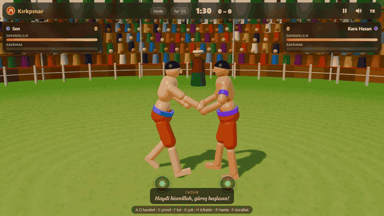
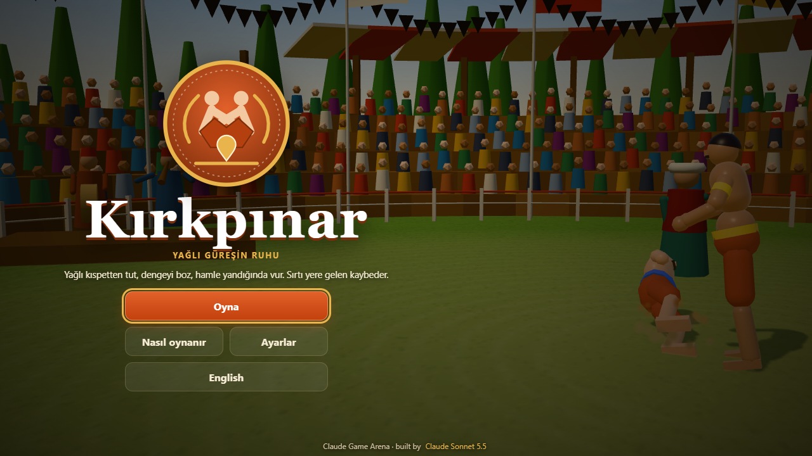
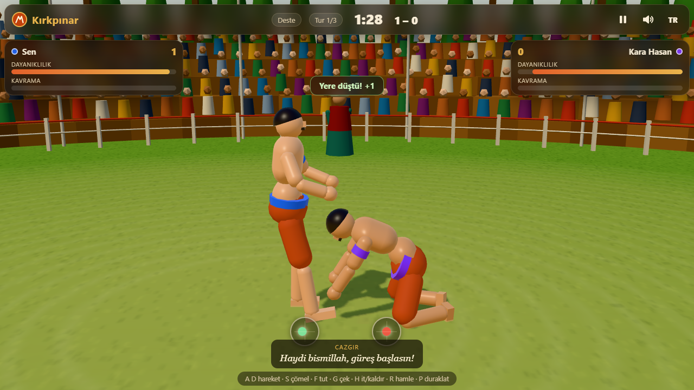
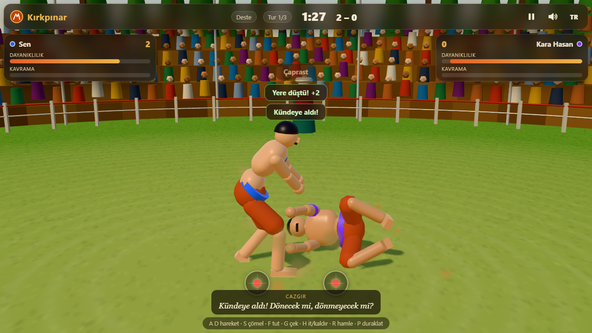
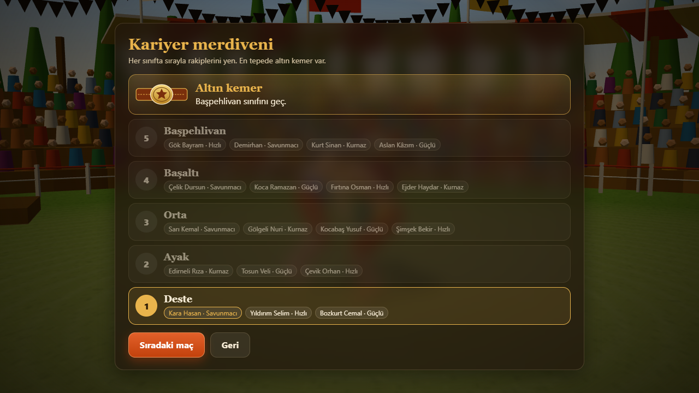
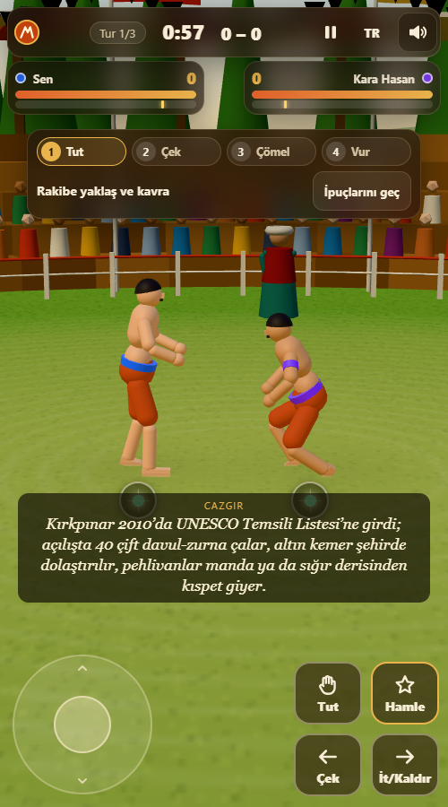
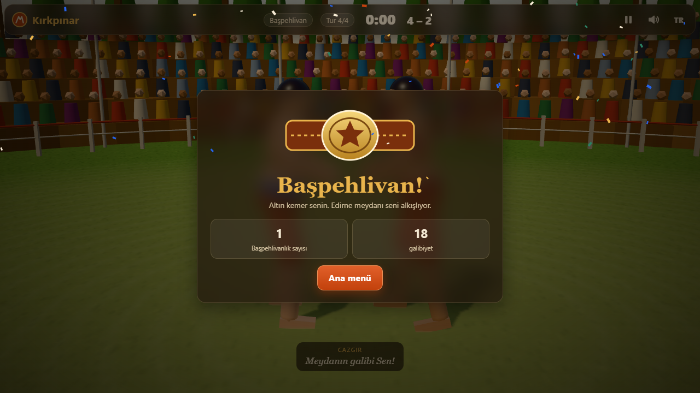

<p align="center">
  <a href="https://furkiozknn.github.io/kirkpinar/"></a>
</p>

<p align="center">
  <a href="https://furkiozknn.github.io/kirkpinar/"></a>
  
  
  <a href="LICENSE"></a>
  
</p>

<p align="center"><b>A 3D physics oil-wrestling (yağlı güreş) game inspired by the Kırkpınar tradition near Edirne: two oiled pehlivans in leather kıspet trousers grip, pull, push and throw until one wrestler's back touches the grass.</b></p>

<p align="center">
  
</p>

<p align="center"><b>Play online: <a href="https://furkiozknn.github.io/kirkpinar/">https://furkiozknn.github.io/kirkpinar/</a></b> (desktop and phone, no install)</p>

## Highlights

- **Oil makes every hold slip.** Grip strength decays with hold time, oil and sweat, effort and stamina, and a grip
  slips when it is overloaded. The kıspet hold is the most reliable under oil.
- **Balance you can read.** Each wrestler is a rigid-segment body with a centre-of-mass lean over his feet. Lean past
  the limit and he steps or falls, and the direction decides back, side or front. The bubble under each wrestler shows
  his balance.
- **The classic finishing moves.** Paça kazık, çaprast, kündeye almak (pin and roll a downed rival onto his back),
  lift and carry three steps, yere çal (slam) and a crouched leg hook, each one a context move that lights up when the
  grip and the rival's balance allow it.
- **Career to the golden belt.** Five weight classes from Deste to Başpehlivan, 3-4 rivals each in four styles (strong,
  fast, defensive, tricky). Plus a quick match and 2 players on one keyboard (behind "More modes"); touch and gamepad
  work too.
- **One click to the first grip (v2).** Play jumps straight to the current career bout: a 2.5 s versus card (any click
  skips it), then the bout starts. A four-step coach strip in the very first bout ticks on real input and the rival plays
  about 25 % weaker until it is done (or skipped).
- **Longer bouts for bigger classes (v2).** Career bouts last 60 / 75 / 90 / 105 / 120 seconds from Deste to
  Başpehlivan, as in the real sport where the final is the longest. Oil keeps building, so late bouts are about pacing.
- **Three years and the belt is yours (v2).** A finished career is one year of the golden belt; three finished careers
  in a row keep it for good (abandoning a run resets the streak) and turn your belt and armband gold.
- **Oil you can see (v2).** Skin gets glossier as oil builds up, every slip throws droplets, the grass darkens where the
  wrestlers stand, and the grip bar shows an oil-limit tick.
- **Cazgır facts (v2).** The cazgır tells a different true fact before the first bout of each class, and result and
  loading cards carry a "Did you know?" line (six sourced facts, TR / EN).
- **Fair AI, tested by a bot.** The AI presses the same buttons through the same simulation as a player. The `?auto`
  bot played a whole career: measured **23 bouts, 18 wins, golden belt** (v2, fast=30; zero JS errors with and without assets), 60 fps, 52 draw calls.
- **One file, made in code.** One `index.html` with Three.js r170 from a CDN; the poses, the slow-motion replay, the
  crowd and every sound are generated in code.

## How to play

> [!TIP]
> **Goal:** put your rival's back (both shoulders) on the grass, or lift him and carry him three steps. Grab first,
> break his balance with pull and push, then strike when the move button lights up.

1. **Close in and grab** (`F`). The first hand takes the arm, the next the waist; hold `S` (crouch) while grabbing to
   take the kıspet.
2. **Break the balance.** Pull (`G`) drags the rival towards you, push (`H`) shoves him away; walking away from a hold
   drags him too. Pulling and pushing wear down your own grip and stamina.
3. **Strike** (`R`) when the move button lights up: a finishing move needs the right grip and an off-balance rival.

<details>
<summary><b>Moves and rules</b></summary>

- **Paça kazık:** kıspet hold, rival off balance.
- **Çaprast:** cross hold (one arm hold, one waist hold), rival off balance.
- **Kündeye al:** the rival is down on the grass: pin him and win the struggle (mash the move button) to roll him onto
  his back.
- **Lift:** hold push with a waist or kıspet hold on an off-balance rival. Carry him three steps to win, or slam him
  (**yere çal**).
- **Trip:** crouch + pull hooks the rival's leg (with a cooldown) and weakens his balance for a moment.
- Falls onto the side or front only score a point for the rival, who can follow up with the künde. Career bouts last
  60 / 75 / 90 / 105 / 120 seconds by class (quick match and 2 players: 90); if nobody wins, more points wins, and a tie
  goes to a 45 second golden score round (first point wins).

</details>

### Controls

| Action | Player 1 | Player 2 (2P mode) | Single player |
|---|---|---|---|
| Move | `A` `D` | `←` `→` | `A` `D` or arrows |
| Crouch / stand tall | `S` / `W` | `↓` / `↑` | `S` / `W` or arrows |
| Grab / release | `F` | `K` | `F` or `K` |
| Pull (crouched: leg hook) | `G` | `L` | `G` or `L` |
| Push (hold: lift) | `H` | `;` | `H` or `;` |
| Context move | `R` | `Enter` or `'` | `R`, `Space` or `Enter` |

Global: `P` / `Esc` pause, `M` music, `X` effects, `L` language (not during a 2-player bout, where it is Player 2's
pull). The speaker button (top right on every screen) mutes music and effects together and is remembered. Touch: a virtual stick (left / right, down to crouch, up to stand tall) and four buttons. Gamepad: stick or
d-pad, `A` grab, `X` pull, `B` push, `Y` move, Start pause.

Settings (master / music / effects volume, mute, TR / EN, Low / High quality, fullscreen) are saved in `localStorage`
under `arena.kirkpinar.settings`; the career run, best results, the coach flag and the golden-belt streak under
`arena.kirkpinar.save`. Turkish is the default
language.

<details>
<summary><b>URL flags for testing</b></summary>

| Flag | Effect |
|---|---|
| `?auto` | a bot plays the whole career by itself, clicking the real menus; `&fast=N` sets the simulation speed (default 6), `&mode=quick` plays one quick match instead, `&sim=N` fast-forwards N seconds at the start of each bout |
| `?debug` | fps, draw calls, triangles, fighter states and JS errors on screen; `window.kirkpinarSim(seconds)`; `&belt=N` (0-3) presets the golden-belt streak |
| `?low` | shadows off, fewer particles and spectators |
| `?lang=en` / `?lang=tr` | start language |
| `?noassets` | accepted for the arena convention; the game uses no external assets anyway |

`window.kirkpinar` exposes the live state (`state` incl. the bout `limit` and per-class `limits`, `screen`, `fps`,
`drawCalls`, `auto`, `coach`, `belt`, `assets`, `errors`).

</details>

## Screenshots

<table>
  <tr>
    <td width="33%"><br><sub>Title screen</sub></td>
    <td width="33%"><br><sub>A fall scores a point</sub></td>
    <td width="33%"><br><sub>Künde: the rival is down</sub></td>
  </tr>
  <tr>
    <td><br><sub>Career ladder to the golden belt</sub></td>
    <td><br><sub>On a phone</sub></td>
    <td><br><sub>Başpehlivan: the golden belt</sub></td>
  </tr>
</table>

## Running locally

Serve the folder over HTTP (ES modules do not load from `file://`):

```
python -m http.server 8000
```

then open <http://localhost:8000/>.

## How it was made

Built by **Claude Sonnet 5.5** with Claude Code from one prompt: [prompts/kirkpinar.md](prompts/kirkpinar.md). No
third-party assets are used; Three.js is loaded from jsDelivr under its MIT licence.

### v2 update

Upgraded by Claude Sonnet 5.5 with Claude Code from [prompts/kirkpinar-v2.md](prompts/kirkpinar-v2.md): one-click Play,
a first-bout coach, a mute button on every screen, bout length that grows with the class, the three-year golden belt,
visible oil (gloss, droplets, stains, grip-bar tick) and cazgır facts. Counts are unchanged (5 classes, the same rival
lists, a 26-bout career). The facts come from the UNESCO listing and Wikipedia (sources are in the code comments).

<details>
<summary><b>Technical notes</b></summary>

- **Simulation** (`SIMLIB`, pure JavaScript, no DOM): each wrestler is a rigid-segment body with a centre-of-mass lean
  vector over his feet. Leaning past his balance limit makes him step (if he can) or fall; the direction decides back,
  side or front. Grips have a strength that decays with hold time, oil and sweat, effort and stamina, and slip when
  overloaded. Pull, push, trip, lift, carry and the finishing moves all act on the lean vectors and grips. Ground work
  (künde) is a small tug-of-war meter.
- **Pose solver:** joints are computed in code every frame (spine bend, tilt about the feet, two-bone IK for arms to
  the grip points on the rival and for legs to planted, stepping feet), then low-poly capsule meshes are oriented
  between the joints. Falls, throws, kneeling, pinning and carrying are the same solver with different parameters.
- **Replay:** the last two seconds of joint arrays are recorded and played back in slow motion from an orbiting camera
  after a decisive finish.
- **Oil rendering (v2):** each wrestler's skin material runs roughness 0.58 to 0.14 (and a stronger reflection) from his
  oil value; the stains are one transparent decal plane whose small canvas is stamped under the wrestlers a few times a
  second, so it costs one extra draw call.
- **Audio:** Web Audio only: a hicaz-flavoured zurna phrase over a 9/8 davul pattern with a drone, crowd murmur,
  cheers, slaps, thuds and whistles.
- **Rendering:** MeshLambert / MeshStandard, one directional light with a 1024 shadow map that follows the pair, merged
  static scenery, instanced spectators, a soft-sprite particle system for oil and dust. No post-processing.

</details>

Kırkpınar is part of the **Claude Game Arena** series, where each game is built by a Claude model from one prompt. The
other games: [Hisar](https://furkiozknn.github.io/kale-savunmasi/) ·
[Çay Ocağı](https://furkiozknn.github.io/cay-ocagi/) · [Çini Ustası](https://furkiozknn.github.io/cini-ustasi/) ·
[Martı](https://furkiozknn.github.io/marti/) · [Kervan](https://furkiozknn.github.io/kervan/) ·
[Dolmuş](https://furkiozknn.github.io/dolmus/) · [Peri Golf](https://furkiozknn.github.io/peri-golf/) ·
[Mehter](https://furkiozknn.github.io/mehter/) · [Boğaz Vapuru](https://furkiozknn.github.io/bogaz-vapuru/) ·
[Simit Fırını](https://furkiozknn.github.io/simit-firini/) · [Karagöz](https://furkiozknn.github.io/karagoz/) ·
[Lale Bahçesi](https://furkiozknn.github.io/lale-bahcesi/)

**Round 5:** [Kapadokya Balonu](https://furkiozknn.github.io/kapadokya-balonu/) ·
[Ebru](https://furkiozknn.github.io/ebru/) · [Çarşı Kaçışı](https://furkiozknn.github.io/carsi-kacisi/)

**Round 6:** [Topkapı Gecesi](https://furkiozknn.github.io/topkapi-gecesi/) ·
[Hamsi](https://furkiozknn.github.io/hamsi/) · [Pamukkale](https://furkiozknn.github.io/pamukkale/) ·
[Mimar Sinan](https://furkiozknn.github.io/mimar-sinan/)

## Türkçe

**Kırkpınar**, Edirne'deki Kırkpınar geleneğinden esinlenen 3D fizikli yağlı güreş oyunu. Kıspetli, yağlı iki
pehlivan er meydanında tutar, çeker, iter ve atar; yağ yüzünden her tutuş yavaşça kayar. Paça kazık, çaprast ve
künde gibi klasik oyunlarla rakibin sırtını yere getir. Deste'den Başpehlivan'a beş sınıflı kariyer ve altın kemer,
hızlı maç ve aynı klavyede 2 oyuncu. Kurulum yok; masaüstünde ve telefonda tarayıcıda oynanır. Claude Sonnet 5.5
tarafından Claude Code ile tek bir prompt'tan yapıldı. v2: tek tıkla ilk tutuşa geçiş, ilk maçta öğretici şerit,
her ekranda ses düğmesi, sınıfla uzayan maç süresi, üç yıl üst üste kazanınca kalıcı altın kemer, gözle görülen yağ ve
cazgırın anlattığı gerçek bilgiler.

**Oyna:** https://furkiozknn.github.io/kirkpinar/

## License

MIT, see [LICENSE](LICENSE).
