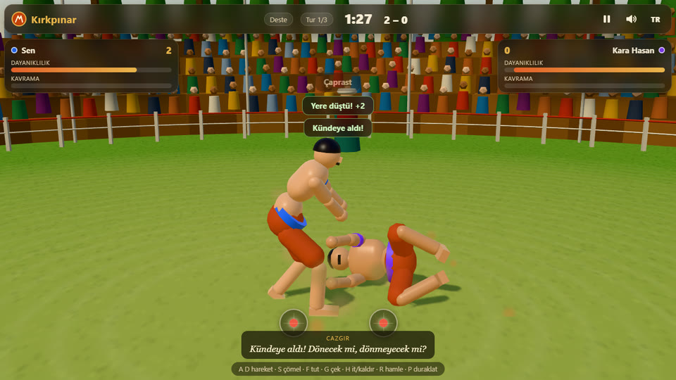
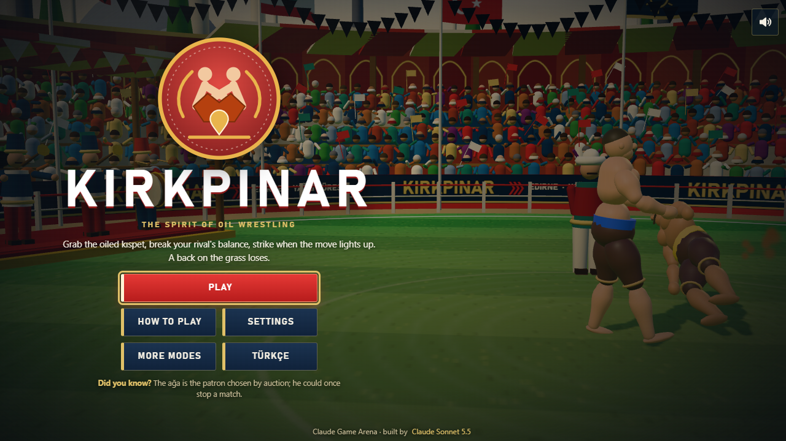
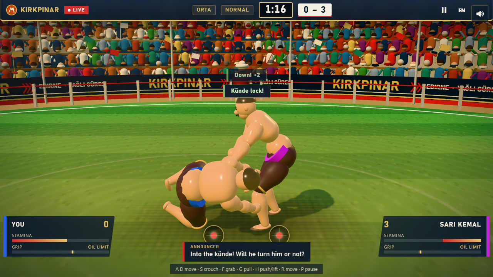
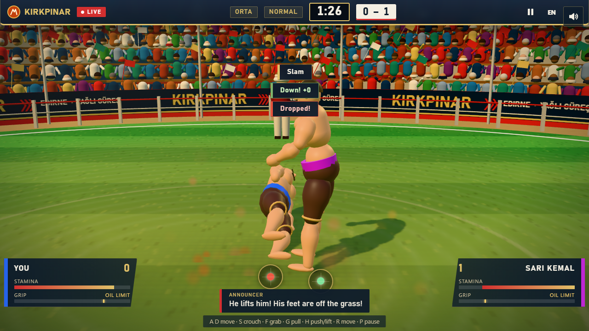
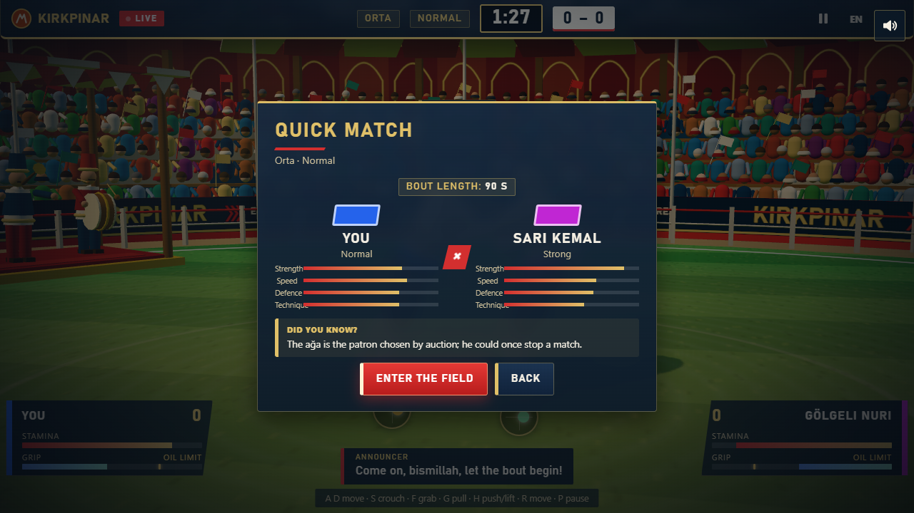
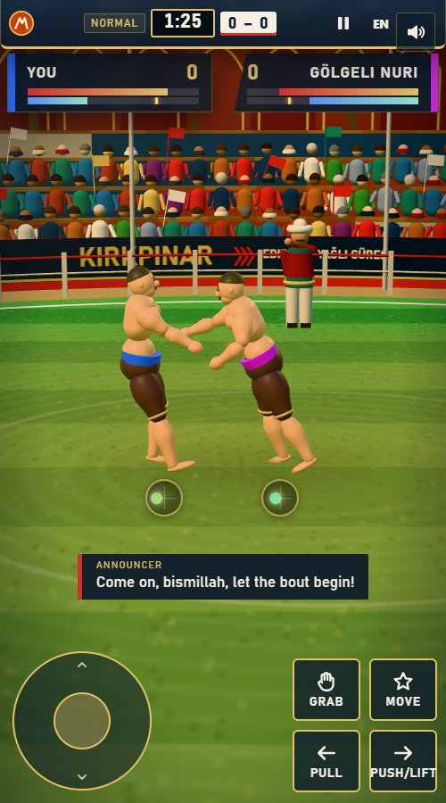
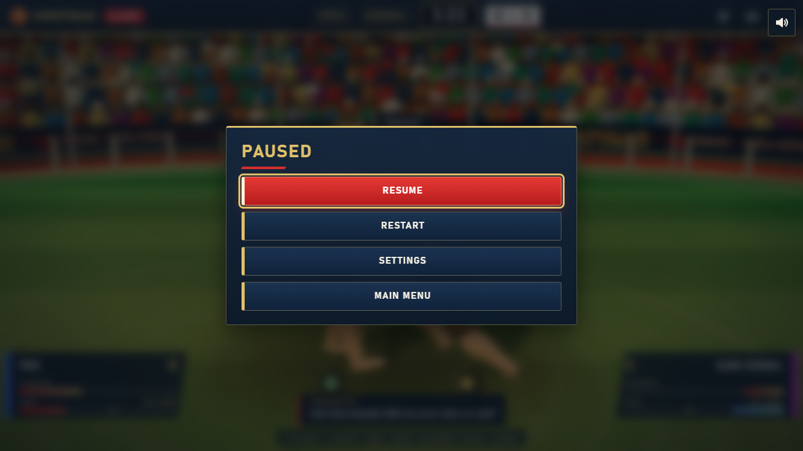
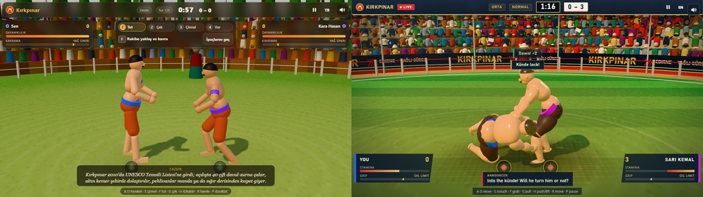

<p align="center">
  <a href="https://furkiozknn.github.io/kirkpinar/">
    
  </a>
</p>

<p align="center">
  <a href="https://furkiozknn.github.io/kirkpinar/"></a>
</p>

<p align="center">
  
  
  <a href="LICENSE"></a>
  
</p>

<!-- portals:start -->
<p align="center">
  Also on: <a href="https://furkiozknn.itch.io/kirkpinar"><strong>itch.io</strong></a> &middot; <a href="https://playgama.ai/play/ciehj6cxilo2lg"><strong>Playgama</strong></a>
</p>
<!-- portals:end -->

<p align="center">
  <strong>A 3D physics oil-wrestling (yağlı güreş) game inspired by the Kırkpınar tradition near Edirne: two oiled pehlivans in leather kıspet trousers grip, pull, push and throw until one wrestler's back touches the grass.</strong>
</p>

<!-- gameplay gif -->

## Features

- **Career to the golden belt:** 5 weight classes from Deste to Başpehlivan, facing 3–4 rivals each across 4 styles (strong, fast, defensive, tricky) in a 26-bout tournament ladder, plus quick match and 2 players on one keyboard.
- **Dynamic bout pacing & stamina:** Bouts scale across 60 / 75 / 90 / 105 / 120 seconds by class (90 s in quick match/2P; 45 s golden score tiebreaker); oil builds up constantly, requiring tactical pacing as grip strength decays.
- **Authentic yağlı güreş moves:** Execute paça kazık, çaprast, kündeye almak (pin and roll a downed rival onto his back), yere çal (slam), crouched leg hooks, and lift & carry for 3 steps when rival balance allows.
- **3-year championship streak:** Complete 3 consecutive career runs without abandoning to permanently secure the golden belt and turn your wrestler's belt and armband gold.
- **Ultra-lean web performance:** A single `index.html` running Three.js r170 delivering 60 fps at 52–65 draw calls on Intel UHD 620 (64 calls, 61 fps on phone), verified by an automated bot across 23 bouts with 0 JS errors.

## How to play

> [!TIP]
> **Goal:** Put your rival's back (both shoulders) on the grass, or lift him and carry him three steps. Grab first, break his balance with pull and push, then strike when the move button lights up.

1. **Close in and grab (`F`):** The first hand takes the arm, the next the waist; hold `S` (crouch) while grabbing to take the kıspet.
2. **Break the balance:** Pull (`G`) drags the rival towards you, push (`H`) shoves him away; walking away from a hold drags him too. Pulling and pushing wear down your own grip and stamina.
3. **Strike (`R`):** Strike when the move button lights up—a finishing move needs the right grip and an off-balance rival.

<details>
<summary><b>Moves and rules</b></summary>

- **Paça kazık:** Kıspet hold, rival off balance.
- **Çaprast:** Cross hold (one arm hold, one waist hold), rival off balance.
- **Kündeye al:** The rival is down on the grass: pin him and win the struggle (mash the move button) to roll him onto his back.
- **Lift:** Hold push with a waist or kıspet hold on an off-balance rival. Carry him three steps to win, or slam him (**yere çal**).
- **Trip:** Crouch + pull hooks the rival's leg (with a cooldown) and weakens his balance for a moment.
- **Scoring & rounds:** Falls onto the side or front only score a point for the rival, who can follow up with the künde. Career bouts last 60 / 75 / 90 / 105 / 120 seconds by class (quick match and 2 players: 90); if nobody wins, more points wins, and a tie goes to a 45 second golden score round (first point wins).

</details>

### Controls

| Action | Player 1 | Player 2 (2P mode) | Single player |
|---|---|---|---|
| Move | `A` `D` | `←` `→` | `A` `D` or arrows |
| Crouch / stand tall | `S` / `W` | `↓` / `↑` | `S` / `W` or arrows |
| Grab / release | `F` | `K` | `F` or `K` |
| Pull (crouched: leg hook) | `G` | `L` | `G` or `L` |
| Push (hold: lift) | `H` | `;` | `H` or `;` |
| Context move | `R` | `Enter` or `'` | `R`, `Space` or `Enter` |

- **Global hotkeys:** `P` / `Esc` pause, `M` music, `X` effects, `L` language (not during a 2-player bout, where it is Player 2's pull).
- **Audio control:** The speaker button (top right on every screen) mutes music and effects together and is remembered.
- **Touch:** A virtual stick (left / right, down to crouch, up to stand tall) and four buttons.
- **Gamepad:** Stick or d-pad, `A` grab, `X` pull, `B` push, `Y` move, `Start` pause.
- **Persistence:** Settings (master / music / effects volume, mute, TR / EN, Low / High quality, fullscreen) are saved in `localStorage` under `arena.kirkpinar.settings`; career run, best results, coach flag, and golden-belt streak under `arena.kirkpinar.save`. Turkish is the default language.

<details>
<summary><b>URL flags for testing</b></summary>

| Flag | Effect |
|---|---|
| `?auto` | A bot plays the whole career by itself, clicking the real menus; `&fast=N` sets the simulation speed (default 6), `&mode=quick` plays one quick match instead, `&sim=N` fast-forwards N seconds at the start of each bout |
| `?debug` | FPS, draw calls, triangles, fighter states and JS errors on screen; `window.kirkpinarSim(seconds)`; `&belt=N` (0-3) presets the golden-belt streak |
| `?low` | Shadows off, fewer particles and spectators |
| `?lang=en` / `?lang=tr` | Start language |
| `?noassets` | Accepted for the arena convention; the game uses no external assets anyway |

`window.kirkpinar` exposes the live state (`state` incl. the bout `limit` and per-class `limits`, `screen`, `fps`, `drawCalls`, `auto`, `coach`, `belt`, `assets`, `errors`).

</details>

## Screenshots

<table>
  <tr>
    <td width="33%"><br><sub>Title screen</sub></td>
    <td width="33%"><br><sub>A fall scores a point</sub></td>
    <td width="33%"><br><sub>Künde: the rival is down</sub></td>
  </tr>
  <tr>
    <td><br><sub>Quick match setup</sub></td>
    <td><br><sub>On a phone</sub></td>
    <td><br><sub>Pause menu</sub></td>
  </tr>
</table>

## Redesign & Performance

**Art direction:** Cinematic sports broadcast. Golden-hour light over a mown field (grass `#3E8E41`, kıspet leather `#4E342E`, oil sheen `#E0C068`, flag red `#D32F2F`, broadcast navy `#0D1B2A`), with a TV-style HUD.

**Visual updates (rules, controls, bot, and saves are untouched):**
- **Scene:** Mown grass stripes and sand track, tiered stands with hoardings, flags, light towers, skyline, and an instanced animated crowd with camera flashes. A davul-zurna band plays on its own stage.
- **Wrestlers:** Smoother capsule-limb rig with an oiled sheen.
- **UI:** Broadcast score bug, lower thirds, navy and gold panels for every screen, phone HUD in one row.

**Measured on an Intel UHD 620 (headless Chrome, 1280x720):**
- Draw calls: 52 &rarr; 65
- Page rAF: ~58–60 fps in gameplay (before: 52–60 fps)
- Phone (500x900): 64 calls, 61 fps
- `?auto&mode=quick` finishes with 0 JS errors, with assets and with `?noassets`; `?lang=en` shows 0 errors.



## Running locally

Serve the folder over HTTP (ES modules do not load from `file://`):

```bash
python -m http.server 8000
```

Then open <http://localhost:8000/>.

## Made with Claude Code

Built by **Claude Sonnet 5.5** with Claude Code from one prompt: [prompts/kirkpinar.md](prompts/kirkpinar.md). No third-party assets are used; Three.js is loaded from jsDelivr under its MIT licence.

### v2 update

Upgraded by Claude Sonnet 5.5 with Claude Code from [prompts/kirkpinar-v2.md](prompts/kirkpinar-v2.md): one-click Play, a first-bout coach, a mute button on every screen, bout length that grows with the class, the three-year golden belt, visible oil (gloss, droplets, stains, grip-bar tick), and cazgır facts. Counts are unchanged (5 classes, the same rival lists, a 26-bout career). Sourced from the UNESCO Representative List (2010) and Wikipedia (sources documented in code comments).

- **One click to the first grip:** Play jumps straight to the current career bout: a 2.5 s versus card (any click skips it), then the bout starts. A four-step coach strip in the very first bout ticks on real input and the rival plays about 25% weaker until it is done (or skipped).
- **Fair AI tested by bot:** The AI presses the same buttons through the same simulation as a player. The `?auto` bot played a whole career: measured **23 bouts, 18 wins, golden belt** (v2, fast=30; zero JS errors with and without assets), 60 fps, 52 draw calls.
- **UNESCO Cazgır facts:** The cazgır recites a true historical fact before the first bout of each class, and result and loading cards display a "Did you know?" line (six sourced facts, TR / EN).

<details>
<summary><b>Technical notes</b></summary>

- **Simulation (`SIMLIB`, pure JavaScript, no DOM):** Each wrestler is a rigid-segment body with a centre-of-mass lean vector over his feet. Leaning past his balance limit makes him step (if he can) or fall; the direction decides back, side or front. Grips have a strength that decays with hold time, oil and sweat, effort and stamina, and slip when overloaded. Pull, push, trip, lift, carry and the finishing moves all act on the lean vectors and grips. Ground work (künde) is a small tug-of-war meter.
- **Pose solver:** Joints are computed in code every frame (spine bend, tilt about the feet, two-bone IK for arms to the grip points on the rival and for legs to planted, stepping feet), then low-poly capsule meshes are oriented between the joints. Falls, throws, kneeling, pinning and carrying are the same solver with different parameters.
- **Replay:** The last two seconds of joint arrays are recorded and played back in slow motion from an orbiting camera after a decisive finish.
- **Oil rendering:** Each wrestler's skin material runs roughness 0.58 to 0.14 (and a stronger reflection) from his oil value; the stains are one transparent decal plane whose small canvas is stamped under the wrestlers a few times a second, costing only one extra draw call.
- **Audio (Web Audio only):** A hicaz-flavoured zurna phrase over a 9/8 davul pattern with a drone, crowd murmur, cheers, slaps, thuds and whistles.
- **Rendering:** MeshLambert / MeshStandard, one directional light with a 1024 shadow map that follows the pair, merged static scenery, instanced spectators, and a soft-sprite particle system for oil and dust. No post-processing.

</details>

### Claude Game Arena

Kırkpınar is part of the **Claude Game Arena** series, where each game is built by a Claude model from one prompt.

[Hisar](https://furkiozknn.github.io/kale-savunmasi/) · [Çay Ocağı](https://furkiozknn.github.io/cay-ocagi/) · [Çini Ustası](https://furkiozknn.github.io/cini-ustasi/) · [Martı](https://furkiozknn.github.io/marti/) · [Kervan](https://furkiozknn.github.io/kervan/) · [Dolmuş](https://furkiozknn.github.io/dolmus/) · [Peri Golf](https://furkiozknn.github.io/peri-golf/) · [Mehter](https://furkiozknn.github.io/mehter/) · [Boğaz Vapuru](https://furkiozknn.github.io/bogaz-vapuru/) · [Simit Fırını](https://furkiozknn.github.io/simit-firini/) · [Karagöz](https://furkiozknn.github.io/karagoz/) · [Lale Bahçesi](https://furkiozknn.github.io/lale-bahcesi/)

**Round 5:** [Kapadokya Balonu](https://furkiozknn.github.io/kapadokya-balonu/) · [Ebru](https://furkiozknn.github.io/ebru/) · [Çarşı Kaçışı](https://furkiozknn.github.io/carsi-kacisi/)

**Round 6:** [Topkapı Gecesi](https://furkiozknn.github.io/topkapi-gecesi/) · [Hamsi](https://furkiozknn.github.io/hamsi/) · [Pamukkale](https://furkiozknn.github.io/pamukkale/) · [Mimar Sinan](https://furkiozknn.github.io/mimar-sinan/)

## License

MIT, see [LICENSE](LICENSE).

Like the game? You can support new rounds on [Buy Me a Coffee](https://buymeacoffee.com/furkiozkann). The game stays free.
